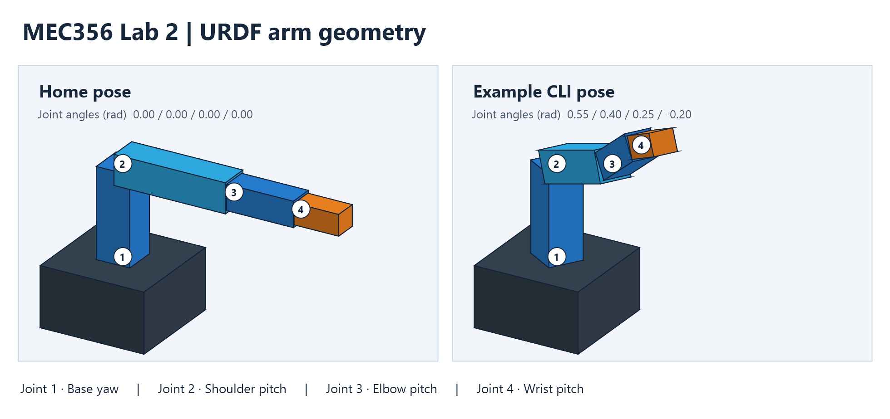
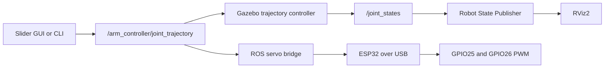

# ROS 2 Robotic Arm

**MEC356 · Design of Mechatronic Systems · Lab 2**

A four-joint arm in Gazebo Harmonic and RViz2, with two ESP32 PWM channels driven by the same ROS 2 trajectory.

[Quick start](#quick-start) · [Controls](#controls) · [ESP32 setup](esp32/ESP32_SETUP.md) · [Verification](#verification)



## Team

| Team member | Student ID |
| --- | --- |
| Osama Medhat | 2304156 |
| Ziad Mohamed | 2304154 |
| Anas Mohamed | 2304149 |

## System overview



| Body | Dimension | Joint |
| --- | --- | --- |
| Fixed base | 8 cm high | — |
| L1 | 12 cm high | Joint 1, base yaw |
| L2 | 15 cm long | Joint 2, shoulder pitch |
| L3 | 9 cm long | Joint 3, elbow pitch |
| End effector | 6 cm long | Joint 4, wrist pitch |

All five bodies have visual, collision, and inertial definitions. Link cross sections, masses, and the ±1.2 rad joint limits are modelling assumptions.

## Quick start

Use Ubuntu 24.04 with ROS 2 Jazzy and the ROS apt repository configured. On Windows with WSL, clone and build inside the Ubuntu filesystem.

```bash
git clone https://github.com/Oselazab/MEC356-Lab2-Project.git
cd MEC356-Lab2-Project
source /opt/ros/jazzy/setup.bash
sudo apt update
sudo apt install python3-colcon-common-extensions python3-rosdep python3-serial python3-tk ros-jazzy-ros2controlcli
# Run sudo rosdep init once if rosdep has not already been initialized.
rosdep update
rosdep install --from-paths src --ignore-src -y
colcon build --symlink-install
source install/setup.bash
ros2 launch mec356_arm lab.launch.py
```

Gazebo and RViz2 open by default. Use `headless:=true` to launch the Gazebo server without the graphical windows.

## Controls

In another Ubuntu terminal, source ROS and the workspace, then open the slider GUI.

```bash
source /opt/ros/jazzy/setup.bash
cd MEC356-Lab2-Project
source install/setup.bash
ros2 control list_controllers
python3 tools/arm_gui.py
```

Wait for `arm_controller` and `joint_state_broadcaster` to be active. Set the four joint targets in radians and click **Send pose**. Click **Send home** to return the joints to zero. The home command preserves the running ROS controllers.

The CLI publishes the same message.

```bash
ros2 run mec356_arm send_pose 0.55 0.40 0.25 -0.20 --seconds 2
ros2 run mec356_arm send_pose 0 0 0 0 --seconds 2
```

## ESP32 and servo interface

On native Linux, upload the [ESP32 PWM sketch](esp32/firmware/esp32_arm_servos/esp32_arm_servos.ino) using Arduino IDE. Close Serial Monitor and add `hardware:=true port:=/dev/ttyUSB0` to the launch command. Use the port assigned to your board. For Windows and WSL, the [ESP32 setup guide](esp32/ESP32_SETUP.md) shows how Arduino IDE can display the board's replies while receiving the ROS commands through the same USB connection.

| Connection | Function |
| --- | --- |
| ESP32 GPIO25 | Servo 1 signal, base yaw |
| ESP32 GPIO26 | Servo 2 signal, shoulder pitch |
| External regulated supply positive | Servo power at the rated voltage |
| External supply ground | Both servo grounds and ESP32 GND |
| ESP32 USB | Host data and board power |

USB serial runs at **115200 baud, 8N1**. Each ASCII line contains `servo1_deg,servo2_deg,duration_ms`. The bridge matches the ROS joint names, clamps the first two joint angles to ±1.2 rad, and maps zero to 90°. The ESP32 interpolates both targets and outputs 50 Hz PWM. The firmware prints the received degrees and reads back the final PWM configuration. Use an appropriately rated supply and start with unloaded servos before attaching linkages.

For a hardware CLI test, add `--subscribers 2` so the publisher waits for both the Gazebo controller and the USB bridge. Allow at least 2.5 seconds for the bridge to connect before sending a pose.

## Verification

| Check | Evidence |
| --- | --- |
| Four-joint motion in Gazebo and RViz2 | [Live motion recording](docs/simulation/gazebo-esp32-demo.mp4) |
| ESP32 target angles and PWM readback in Arduino IDE | [Serial Monitor screenshot](docs/simulation/arduino-serial-monitor-proof.jpg) |
| Build and integration checks | [Verification notes](PROJECT_HANDOVER.md) |
| Physical two-servo motion | Pending. The ESP32 was tested with the servos disconnected. |

## Repository layout

| Path | Contents |
| --- | --- |
| [`src/mec356_arm`](src/mec356_arm/) | ROS 2 package, URDF, Gazebo world, RViz2 config, publisher, and serial bridge |
| [`tools`](tools/) | Desktop slider controls |
| [`esp32`](esp32/) | ESP32 firmware and Windows/WSL USB relay |
| [`firmware/arm_servos`](firmware/arm_servos/) | Optional Arduino Nano firmware |
| [`docs/simulation`](docs/simulation/) | Demo recordings and screenshots |
| [`.github/workflows`](.github/workflows/) | Build and integration workflows |
